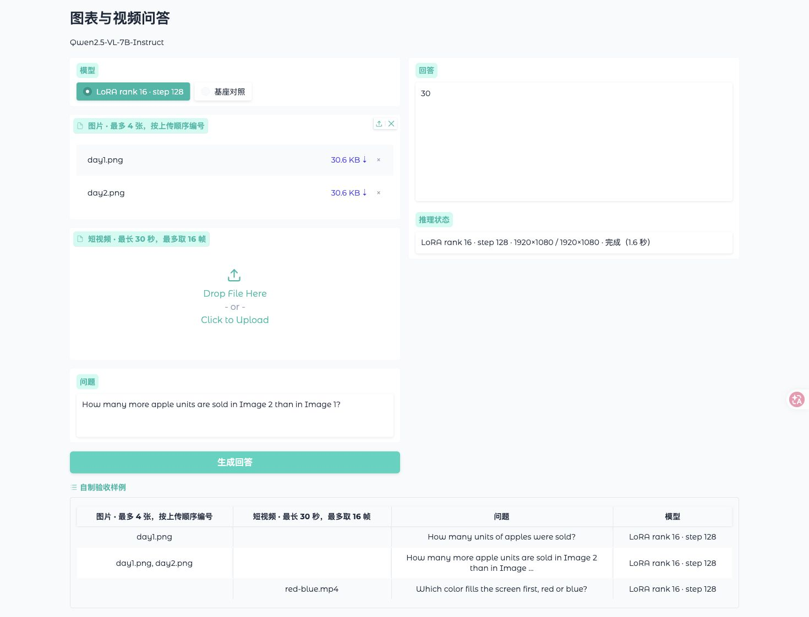
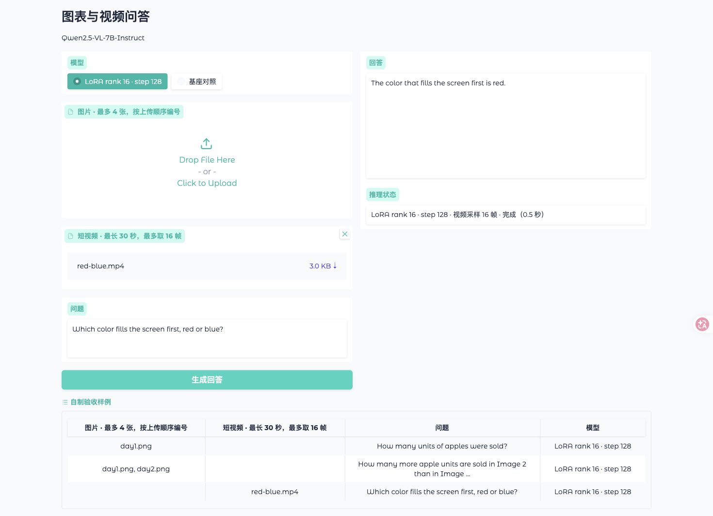

## 项目

基于 Qwen2.5-VL-7B-Instruct 的图表与短视频多模态视觉语言助手。支持高清图、多图和短视频上传，按时间采帧，支持切换基座与 LoRA 对照及流式回答。

- 学号与姓名：〔待填写〕
- 公开代码与固定版本：[sglang-vlm-budget / phase1-v1.0.0](https://github.com/Yun-hshs/sglang-vlm-budget/tree/phase1-v1.0.0)
- [在线 Demo](https://dc9fa8a96886798c5a.gradio.live)
- [一键启动](https://github.com/Yun-hshs/sglang-vlm-budget/blob/phase1-v1.0.0/02-Multimodal/phase1-assistant/DEMO.md)
- 报告文件：`LLM-Course-Assignments-2026/02-Multimodal/submissions/学号-姓名-02-Multimodal.md`

## 主要结果

固定 256 条训练样本，在单张 RTX 5090 上分别训练 rank 8 和 16。用独立验证子集选 checkpoint 后，对 ChartQA 全部 2,500 题做配对评估。三组均无推理失败。

| 模型 | Human | Augmented | 总分 |
|---|---:|---:|---:|
| 基座 | 53.68% | 42.80% | 48.24% |
| rank 8 · step 256 | 74.72% | 92.72% | 83.72% |
| rank 16 · step 128 | 75.92% | 92.24% | 84.08% |

结果包含格式适配的收益。报告附有单位表达退化、数值读数错误和成功纠正的原始样本 ID，可从官方测试分片重查。

## 关键 Demo 截图

两张 1920×1080 自制图的差值题，回答为 30。

四秒自制短视频，采样 16 帧并判断红色先出现。

## 自评依据

- 完整性与复现：固定模型与数据版本，从校验过的分片复现清洗、训练、选点、全量测试和 Demo。
- 技术工作：同一训练顺序的 LoRA 秩对照，逐题配对与单位格式诊断。
- 报告与展示：架构图、训练和验证表、完整测试结果、错例及三类媒体的实测截图。
- 过程与贡献：〔提交人核实本学期规则后填写个人贡献、工具使用说明及实际过程记录〕。
