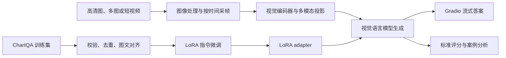

# 阶段 1 · 面向图表与短视频的多模态视觉语言助手

已实现数据准备与基座推理，复现命令与验收记录见 [BASELINE.md](BASELINE.md)。小规模 LoRA 已完成训练、保存、重载和逐题对比，见 [LoRA 复现指南](LORA.md)。rank 8/16 已完成验证选点与 ChartQA 全量测试，见 [正式消融记录](ABLATION.md)。单卡公开 Demo 已上线并通过三类媒体上传验收，见 [部署指南](DEMO.md)。

[正式实验报告](reports/final-report.md) · [在线 Demo](https://dc9fa8a96886798c5a.gradio.live) · [一键启动指南](DEMO.md)

```bash
# 准备兼容的 CUDA 版 PyTorch、基座及已验证 adapter 后，在本目录执行
python -m pip install -r requirements-demo.txt
SHARE=1 bash scripts/start_demo.sh
```

## 技术路线

以**数值图表推理**为主任务。Demo 展示高清图表读数、跨图表比较和短视频事件顺序问答。基座采用 Qwen2.5-VL-7B-Instruct，单张 RTX 5090 运行 BF16 推理。小规模 LoRA 使用 Transformers 与 PEFT 实现，后续由 Gradio 提供上传与流式答复。 [Qwen 模型卡](https://huggingface.co/Qwen/Qwen2.5-VL-7B-Instruct)



## 实施顺序与完成条件

| 顺序 | 工作 | 完成证据 |
|---|---|---|
| 1 | 固定数据来源、模型 revision 和框架版本，用少量样本打通数据转换 | 数据说明、清洗前后统计、manifest 与抽查样本 |
| 2 | 打通基础模型的高清单图、编号多图、带时间信息的视频推理 | 三类输入均返回真实模型答复，记录输入尺寸与采样时间 |
| 3 | 完成小规模 LoRA 冒烟，再运行正式微调与秩消融 | 可加载 adapter、训练配置、训练日志与权重版本 |
| 4 | 评估基础模型和微调版本，收集成功与失败案例 | 逐题预测、标准分数、失败率、视觉结果与误差分析 |
| 5 | 完成 Gradio、一键启动和公开仓库交付，向课程仓库提交报告 | 从干净环境复现、可访问 Demo、正式报告及课程 PR |

## 数据清洗与切分

1. 用 ChartQA 官方数据做主训练和评估。保留官方 train / val / test。train 用于训练，val 选择配置与 checkpoint，配置锁定后统一评估 test。另收集获准展示的短视频和多图题，附人工参考答案及相关时间段。 [ChartQA 官方仓库](https://github.com/vis-nlp/ChartQA)
2. 检查媒体是否可解码、问题和答案是否有效、媒体和占位符是否按顺序对应。按图片哈希和问答检查重复，审核近重复图表跨切分情况，优先从训练集移除冲突项以保持官方测试集可比。自建拆分以图表为分组单位。记录样本 ID、来源版本、类型、引用的媒体和哈希。
3. 保留数字、单位和百分号等影响语义的内容，按 LlamaFactory 格式导出会话与媒体字段。ChartQA 用原题和标准短答案监督，有参考解法时才纳入已有的步骤标注。交付清洗统计、拒绝原因和可复现样本清单。原始数据留在本地，下载和再分发条件分别核实。 [上游多模态数据格式](https://github.com/hiyouga/LlamaFactory/blob/main/data/README.md)
4. 首轮微调以 ChartQA 为主，视频和多图先做独立验收。若微调后出现退化，可加入已授权的图像或视频指令样本，随后单独评估数据构成的影响。

## LoRA 指令微调

建议先用 BF16 LoRA，冻结视觉编码器和投影/融合层，训练语言侧线性层的 adapter。起始比较 rank 8 与 rank 16，固定目标层、数据、种子、有效 batch、步数和解码参数，保持 `alpha / rank` 比例一致。GPU 到位后先校验真实图文 batch、assistant 标签掩码和训练参数清单。少步训练后保存并重载 adapter，确认可生成，再扩大数据与步数。BF16 显存不足时，先调整 batch 或图像预算，再考虑 4-bit QLoRA。各对比组采用同一量化方式。

保存基础模型 revision、框架版本、训练样本清单、LoRA 配置、训练曲线、checkpoint 选择依据和 adapter 哈希。公共仓库提供配置与获取方法，发布 adapter 前核对所用模型和数据的条款。

## 图像、视频与 Demo

- **高清单图**支持原始图输入及可配置像素上限，使用一张小字号高清图表核验实际读数，记录处理后尺寸。
- **多图**按上传顺序保留图 1、图 2 等编号，准备至少一个必须跨图对照才能答对的数值问题。
- **短视频**先支持 MP4，初始上限可用 30 秒、16 帧。按时间均匀取帧，保存时间戳或采样 FPS，通过所锁模型处理器的原生视频入口传入。界面显示取帧摘要，用事件先后问题验证时序。
- **一键启动**计划提供 `bash scripts/start_demo.sh`。检查依赖与模型资产后启动 Gradio，默认加载最终选定且通过评测的配置，并支持切换基础模型作对照。提交前从干净环境复现，验证评阅者可打开链接、上传媒体并得到新的答复。

## 评测与消融

| 组 | 设置 | 对比目的 |
|---|---|---|
| A | 同一基础模型，无 adapter | 基线 |
| B | ChartQA LoRA，rank 8 | 微调前后变化 |
| C | 同一训练集、步数和提示，rank 16 | LoRA 秩的影响 |
| D，可选 | 固定预算调整训练数据构成，或启用投影层更新 | 针对失败样本的额外验证 |

用固定的标准实现计算 ChartQA relaxed accuracy，分别报告 human / augmented 两个子集的分数、样本数与失败次数。固定解码、图像处理、提示和评分口径。用验证集选择配置，再统一跑测试集。保存逐题预测、参考答案、评分和失败原因。 [ChartQA 论文](https://aclanthology.org/2022.findings-acl.177/)

另外验收高清读数、跨图比较与视频时序，按同一批样本对照基础模型与最终 adapter。报告保留真实成功与失败案例，并标注可见的图表证据或帧时间。若 ChartQA 提升但多图或视频退化，记录两方面结果。MMMU 与公开视频基准可在核心交付达标后补充。标准基准分数已经满足题面对评测方式的选择要求。

## 预计代码布局

| 路径 | 实现阶段内容 |
|---|---|
| `data/` | 数据来源、下载、清洗、切分与对齐 |
| `training/`、`configs/` | LoRA SFT 配置和训练入口 |
| `inference/`、`demo/` | 高清图、多图、视频推理与交互 |
| `evaluation/`、`tests/` | 标准评分、逐题输出与功能验收 |
| `scripts/` | 数据准备、训练、评测、一键启动 |
| `reports/` | 架构图、消融表、视觉案例与报告工作稿 |

下一次进入实现时，先用少量样本打通数据清洗和媒体对齐，再完成统一推理入口与评分接口。GPU 到位后优先验证三类输入和 adapter 保存、加载，再执行正式训练。最终报告与 PR 见[提交说明](../SUBMISSION.md)。
