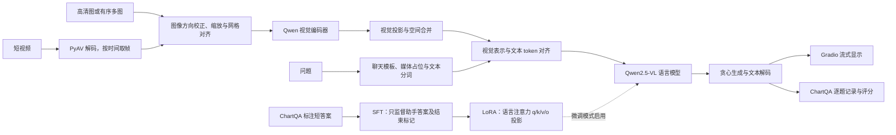
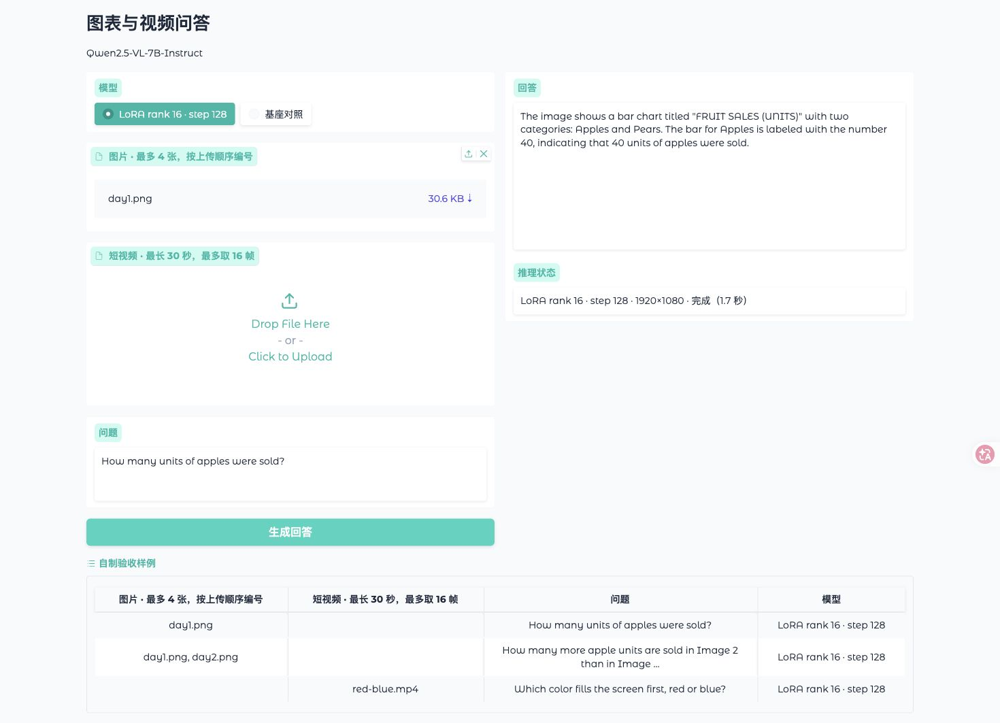
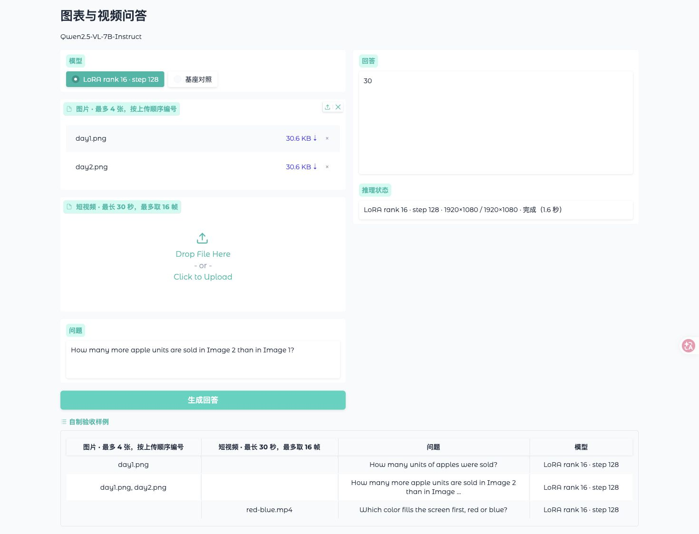
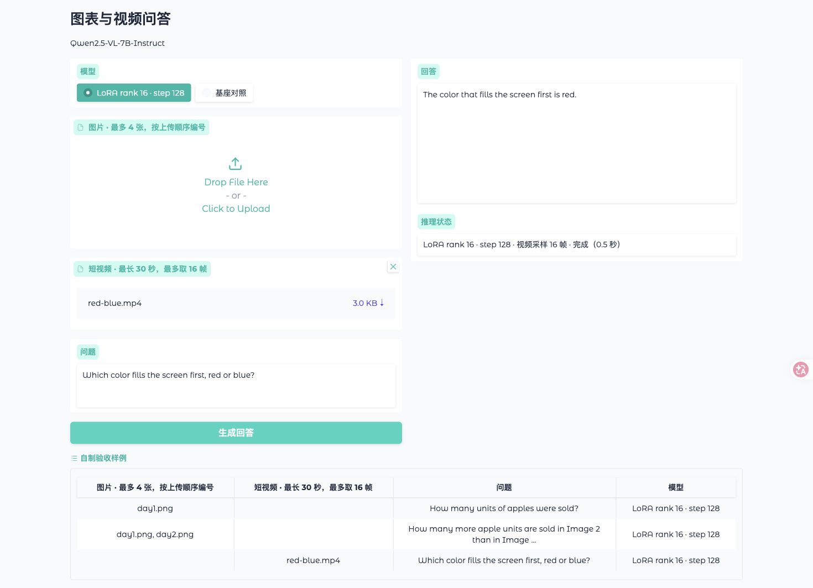

# 基于 Qwen2.5-VL 的图表与短视频问答助手

方向 02 · 图形图像及多模态综合作业

实验日期 2026-11-23

[独立公开代码仓库](https://github.com/Yun-hshs/sglang-vlm-budget) · [在线 Demo](https://dc9fa8a96886798c5a.gradio.live) · [启动与复现说明](../docs/DEMO.md)

## 摘要

本项目实现一个支持高清单图、多图和短视频的视觉语言助手，研究小规模图表指令微调能否改善开源视觉语言模型的图表问答表现。系统基于 Qwen2.5-VL-7B-Instruct，在单张 RTX 5090 上使用 256 条清洗后的 ChartQA 样本训练 LoRA rank 8 和 rank 16，再按预先固定的验证规则选取 checkpoint。在保持测试设置一致的条件下，三组模型均完成官方 test 的全部 2,500 道题。基座取得 48.24% relaxed accuracy，验证集选出的 rank 8 和 rank 16 分别取得 83.72% 与 84.08%。人工复核发现，输出格式适配贡献了部分分数变化，计数和数值推理也有改善与退化并存。Gradio 验收通过高清图读数、跨图差值和短视频时序问答，界面支持切换基座与流式输出。

## 1. 任务与技术选择

ChartQA 将图表视觉识别与文字问答结合，既包含标题、图例和单值读取，也包含计数、差值、排序等任务。本项目针对图表问答开展监督微调和完整量化评测。高清、多图与视频是系统输入功能，视频功能以时间顺序用例验收，未纳入 ChartQA 的质量分数。选择 Qwen2.5-VL-7B-Instruct 是因为它支持图像和原生视频输入，并可使用同一模型处理图文任务。 [ChartQA 论文](https://aclanthology.org/2022.findings-acl.177/) · [Qwen 模型卡](https://huggingface.co/Qwen/Qwen2.5-VL-7B-Instruct)

## 2. 多模态架构

图 1。推理路径从图像或视频开始，经视觉编码和投影后进入语言模型。训练只更新语言注意力层上的 LoRA 参数，视觉编码器、投影层和基座权重冻结。Demo 以同一份模型权重提供两种模式，基座对照在生成期间停用 adapter。图片按上传顺序编号，视频以采样时间和原生视觉网格进入模型。

## 3. 数据集、清洗与切分

固定数据镜像 revision `b605b6e08b57faf4359aeb2fe6a3ca595f99b6c5`。下载五个 Parquet 分片并校验 SHA-256。清洗检验媒体可解码、问答非空以及图像路径与标注对齐。图像经方向校正与 RGB 转换，使用规范化后的 PNG 哈希检测完全相同的图片。先保留全部测试题，再从验证池排除与测试图像重叠的候选，训练候选与整个官方验证和测试集做相同图像筛查，并去除重复图文问答。导出样本保留原始分片和行 ID。 [数据镜像](https://huggingface.co/datasets/HuggingFaceM4/ChartQA) · [原始项目](https://github.com/vis-nlp/ChartQA)

| 切分 | 源记录数 Human / Augmented | 实验使用 Human / Augmented | 用途 |
|---|---:|---:|---|
| Train | 7,398 / 20,901 | 128 / 128 | 固定种子抽样，两组 LoRA 复用 |
| Val | 960 / 960 | 64 / 64 | 从排除两条测试图像重叠记录后的池中分层抽样 |
| Test | 1,250 / 1,250 | 1,250 / 1,250 | 保留全部题目，按验证选点后运行 |

导出的三份清单之间无完全相同的图像哈希。不同题目可共用同一张图，本实验保留测试集中的这类题目。近重复、标注偏差和基座预训练是否接触过这些数据均未核实。 [数据审计与哈希](ablation/data-audit.json)

## 4. 指令微调与消融设计

基座版本固定为 `cc594898137f460bfe9f0759e9844b3ce807cfb5`。实验使用一张 RTX 5090、BF16 基座、PyTorch 2.13.0+cu130、Transformers 5.12.1 与 PEFT 0.20.0。两组共用 256 条训练样本、完全相同的顺序、随机种子 42、AdamW、学习率 1e-4、最大梯度范数 1.0、每步一条样本、一个 epoch 及冻结策略。训练图像预算为 200,704 像素。用聊天模板构建样本，屏蔽用户问题和视觉 token 的损失，仅监督助手答案和回合结尾。

| 配置 | LoRA rank | Alpha | 可训练参数 | 训练与保存用时 | PyTorch 峰值分配 |
|---|---:|---:|---:|---:|---:|
| LoRA-8 | 8 | 16 | 5,046,272 | 177.87 秒 | 16,681 MiB |
| LoRA-16 | 16 | 32 | 10,092,544 | 181.86 秒 | 16,739 MiB |

用时不含基座加载。两组 `alpha / rank` 固定为 2，在第 128、256 步各保存一次。使用同一份 128 条验证清单按总正确数选点，同分时取较早 checkpoint。测试启动前锁定选点与权重哈希。

| Rank | 第 128 步 | 第 256 步 | 选点 |
|---|---:|---:|---:|
| 8 | 110/128 | 114/128 | 第 256 步 |
| 16 | 112/128 | 110/128 | 第 128 步 |

[运行计划](ablation/experiment.json) · [训练 rank 8](ablation/train-rank-8.json) · [训练 rank 16](ablation/train-rank-16.json) · [验证选点](ablation/selection.json)

## 5. 全量测试与误差分析

三组测试使用同一份 2,500 题清单、同一图像预算 200,704 像素、相同提示词和贪心生成，批大小 8，最多生成 24 token。数值答案用 5% 相对误差容限，真值为零时要求数值等于零。评分将百分数转换为对应小数，非数值答案以去除首尾空白并忽略大小写后精确匹配。对照脚本核验模型版本、配置、清单和逐题参考答案。7,500 条测试记录全部成功，独立复算分数一致。

| 模型 | Human（1,250） | Augmented（1,250） | 总计（2,500） |
|---|---:|---:|---:|
| 基座 | 671/1,250（53.68%） | 535/1,250（42.80%） | 1,206/2,500（48.24%） |
| LoRA-8，step 256 | 934/1,250（74.72%） | **1,159/1,250（92.72%）** | 2,093/2,500（83.72%） |
| LoRA-16，step 128 | **949/1,250（75.92%）** | 1,153/1,250（92.24%） | **2,102/2,500（84.08%）** |

相对基座，rank 8 纠正 939 题、退化 52 题，rank 16 纠正 940 题、退化 44 题。rank 16 总分仅领先 rank 8 0.36 个百分点（9 题），且 Augmented 略低。两组选点步数不同，实验只有一个随机种子，因此该差异只描述本轮选模策略下的结果。

| 子集 / test 行号 | 任务与问题类型 | 参考 | 基座 | rank 8 | rank 16 |
|---|---|---|---|---|---|
| Human / 0 | 计数，柱状图中的食物类目 | `14` | `13` | `14` | `14` |
| Human / 28 | 参考以小数表达的百分数 | `0.6` | `60%` | `60` | `60` |
| Human / 1 | 两个图表数值求差 | `0.57` | `0.4` | `0.37` | `0.37` |
| Augmented / 1252 | 线上销售占比的数值和单位 | `6.8` | `6.8%` | `6.8` | `6.8` |
| Augmented / 1265 | 读取指定年份的服务收入 | `555` | `553` | `83` | `85` |
| Augmented / 1255 | 读取指定年份的公司数 | `23` | `28` | `28` | `28` |

基座有 383 条错题的答案带百分号，去掉后数值落入无百分号标注的容差。两组 LoRA 均无这类格式失分。这个诊断未计入正式分数。其反方向退化说明，模型更常输出数字不保证单位表达正确。表中也出现格式之外的计数纠正和读数退化，无法仅凭总分衡量推理增益。 [基座](ablation/test-base.json) · [rank 8](ablation/test-rank-8.json) · [rank 16](ablation/test-rank-16.json) · [分组错例](ablation/results.md)

## 6. Demo 与视觉结果

Demo 在单张 RTX 5090 上默认加载 rank 16 第 128 步的 adapter，支持基座对照。下图是 Chrome 通过 SSH 本地转发打开同一台服务器的 Gradio 界面后得到的真实推理截图。公开链路验收还验证了单图 `40`、双图差值 `30`、视频先出现 `red`（采样 16 帧）。基座长回答通过流式接口接收 18 次不同的正文更新。 [公开链路验收记录](demo/public-smoke.json)

图 2。读取 1920×1080 自制图表，回答苹果销量为 40。

图 3。选择双图样例，模型在按上传顺序排列的两张高清图上计算差值并返回 30。

图 4。短视频时序问答。服务处理 16 帧，正确判定红色先出现。

## 7. 复现与局限

按 [一键启动指南](../docs/DEMO.md) 准备基座与 adapter 后运行 `bash scripts/start_demo.sh`。按 [消融复现指南](../docs/ABLATION.md) 重建数据和全量测试。公开仓库包含训练、测试与部署代码、配置、适量结果汇总以及自制示例。ChartQA 分片由出处单独获取，已训练权重通过仓库中脚本复现。

实验基于较小的 SFT 样本、单种子和单一主基准。视频、跨图综合推理及高分辨率 OCR 需要更大的独立验收集。部分数据的答案单位约定会影响绝对分数。后续课程实验可以增加固定步数对照和多个训练种子，补充按题型分组及独立视频测试。在线链接依赖运行进程与临时分享服务。

本项目在有限算力下完成了从抽样清洗、LoRA 训练、验证选点到完整测试、在线问答的流程。结果支持在该训练与评分协议上开展进一步核验，也指出单位表达和复杂读图仍需改进。

## 工具辅助说明

本项目由用户确定任务、模型、实验阶段并提供 GPU 服务器。Codex 辅助实现代码、运行实验、复核输出并整理文档。课程上游对独立完成有要求。署名、个人贡献和工具使用边界由提交人依据课程通知核实。

## 参考资料

- Masry et al. *ChartQA: A Benchmark for Question Answering about Charts with Visual and Logical Reasoning*，Findings of ACL 2022。 [论文](https://aclanthology.org/2022.findings-acl.177/)
- Qwen Team. *Qwen2.5-VL Technical Report*。 [报告](https://arxiv.org/abs/2502.13923) · [基座模型](https://huggingface.co/Qwen/Qwen2.5-VL-7B-Instruct)
- Hu et al. *LoRA: Low-Rank Adaptation of Large Language Models*。 [论文](https://arxiv.org/abs/2106.09685) · [PEFT 实现文档](https://huggingface.co/docs/peft/en/package_reference/lora)
